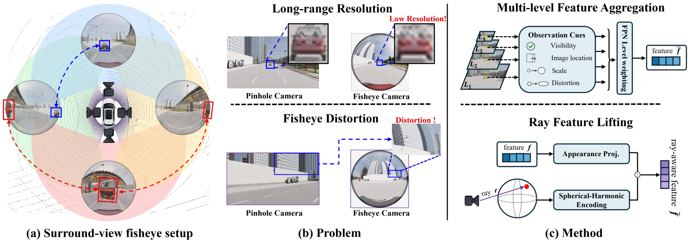
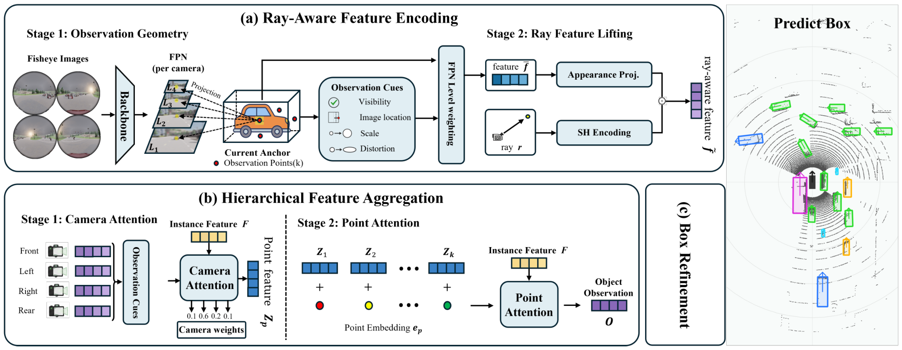
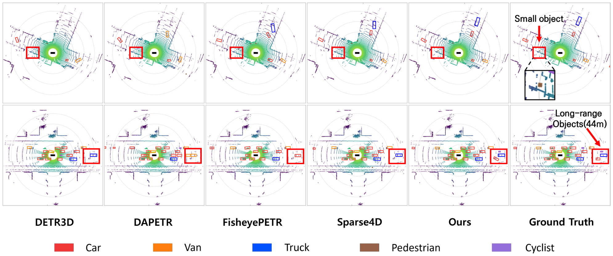
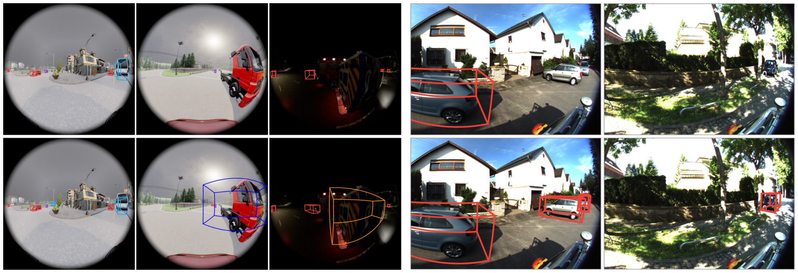

# ROSA

**[WACV 2027] Ray-aware Observation Selection and Aggregation for Surround-View Fisheye 3D Detection**

This repository is the official PyTorch implementation of **ROSA**, accepted to WACV 2027.

DongHun Kim, Sang Jun Lee, HyungGi Jo<sup>†</sup> &nbsp;&nbsp;<sub><sup>†</sup> Corresponding author</sub>

## News

- **[2026/10/15]** ROSA has been accepted to WACV 2027!
- **[2026/10/15]** The official implementation is now publicly available.

## Abstract

A fisheye lens bends and compresses the image differently at every location,
so two samples of the same object are not interchangeable. ROSA measures the
condition of each projected observation — visibility, image location, scale,
distortion — and lets the model weight pyramid levels and camera views by it,
while the calibrated viewing ray is lifted into the feature through spherical
harmonics.

<p align="center">
  
</p>

---

## Installation

Requires **mmcv 2.x** — `mmcv-full` (1.x) imports `mmcv.runner` and will not
work. Full details in [docs/INSTALL.md](docs/INSTALL.md).

```bash
conda create -n rosa python=3.10 -y && conda activate rosa
pip install torch --index-url https://download.pytorch.org/whl/cu128
pip install -r requirements.txt

# ROSA reuses the released Fisheye3DOD evaluator and VoVNet-99 rather than
# vendoring third-party code
git clone https://github.com/weiyangdaren/Fisheye3DOD external/fisheye3dod
export FISHEYE3DOD_OFFICIAL_ROOT=$PWD/external/fisheye3dod
export PYTHONPATH=$PWD:$FISHEYE3DOD_OFFICIAL_ROOT:$PYTHONPATH

# required: the released configs run the fused observation path, whose kernels
# are not built automatically (see ops/README.md)
cp -r ops/* $FISHEYE3DOD_OFFICIAL_ROOT/projects/mmdet3d_plugin/ops/
(cd $FISHEYE3DOD_OFFICIAL_ROOT/projects/mmdet3d_plugin/ops && python setup.py develop)
```

## Data

Download the benchmarks and point ROSA at them — see
[docs/DATA.md](docs/DATA.md) for the expected layout and for rebuilding the
KITTI-360 info files from the raw dataset.

```bash
export ROSA_DATA_ROOT=/path/to/Fisheye3DOD
export ROSA_KITTI360_ROOT=/path/to/KITTI-360    # six-class, 2 Hz
```

## Train

```bash
# Fisheye3DOD — ResNet-18, 20 epochs, two GPUs
torchrun --standalone --nproc_per_node=2 tools/run.py \
    configs/fisheye3dod/rosa_r18_fisheye3dod_20e.py \
    --launcher pytorch train

# KITTI-360 — VoVNet-99, 24 epochs, two GPUs
torchrun --standalone --nproc_per_node=2 tools/train_kitti360.py \
    configs/kitti360/rosa_vov99_kitti360_24e.py \
    --launcher pytorch
```

The released configs carry the exact training recipe the reported numbers were
produced with: AdamW at `lr 2e-4` with `weight_decay 1e-3`, the image backbone
at half that learning rate, a 500-iteration linear warm-up into a cosine
schedule, gradient clipping at ℓ2 norm 25, batch size 4 per GPU, seed 3407.
Set `ROSA_SEED` to repeat a run under a different draw. Baseline configs for
both datasets are under [`benchmarks/`](benchmarks/).

## Evaluate

```bash
python tools/run.py configs/fisheye3dod/rosa_r18_fisheye3dod_20e.py \
    evaluate work_dirs/rosa_r18_fisheye3dod_20e/epoch_20.pth
```

## Benchmark runtime

```bash
python tools/run.py configs/fisheye3dod/rosa_r18_fisheye3dod_20e.py \
    benchmark --checkpoint <ckpt> --output runtime.json \
    --warmup 200 --iterations 300
```

Runtimes are batch size 1 over 300 timed iterations on a single RTX PRO 6000
Blackwell, with backbone and decoder layers compiled. `torch.compile` needs a
few hundred iterations before timings settle, so `--warmup 200` is not
optional for a fair number.

Pretrained checkpoints are on the [Releases](../../releases) page — see
[docs/MODEL_ZOO.md](docs/MODEL_ZOO.md).

---

## Method

<p align="center">
  
</p>

Observation points generated from the current anchor are projected into the
fisheye views, where multi-level features are encoded together with the
geometry of their projection and the direction they were seen from. The
resulting ray-aware features are aggregated across camera views and then
across observation points, and the refined anchor decides where the next
decoder stage observes.


## Repository layout

```
rosa/                     core package
├── observation.py        observation cues and multi-level sampling
├── fisheye_evidence.py   condition-aware camera/level evidence
├── rfl.py                ray feature lifting (spherical harmonics)
├── attention.py          camera and point attention
├── refiner.py            gated box refinement
├── hybrid_box_decoder.py direction + log-range box state
├── fisheye_projection.py OCam projection (Fisheye3DOD)
├── mixed_projection.py   pinhole + MEI projection (KITTI-360)
└── integrations/         dataset, metric and detector bindings
configs/                  released training configurations
├── fisheye3dod/          ResNet-18, 20 epochs
└── kitti360/             VoVNet-99, 24 epochs
benchmarks/               baseline detectors, per dataset
tools/                    train / evaluate / benchmark entry points
└── data_converter/       KITTI-360 info and anchor builders
assets/                   anchor files and figures
```

## Results

### Fisheye3DOD (ResNet-18, 20 epochs)

| Method | mAP | FDS | mATE | mASE | mAOE | AP<sub>car</sub> | AP<sub>ped</sub> | AP<sub>cyc</sub> | FPS |
|---|---|---|---|---|---|---|---|---|---|
| PETR | 0.3303 | 0.4444 | 0.7431 | 0.1731 | 0.4085 | 0.4069 | 0.2369 | 0.3402 | 48.3 |
| SRCN3D | 0.3366 | 0.4364 | 0.7628 | 0.2178 | 0.4106 | 0.4362 | 0.2455 | 0.3394 | 35.2 |
| DAPETR | 0.3604 | 0.4581 | 0.7330 | 0.1648 | 0.4344 | 0.4249 | 0.2610 | 0.3722 | 43.6 |
| Graph-DETR3D | 0.3876 | 0.4781 | 0.6873 | 0.1658 | 0.4412 | 0.4465 | 0.3032 | 0.3995 | 39.7 |
| FisheyePETR | 0.3883 | 0.4842 | 0.7110 | 0.1413 | 0.4075 | 0.4607 | 0.2660 | 0.3885 | 42.6 |
| FisheyeBEVDet | 0.3987 | 0.5000 | 0.5821 | 0.1616 | 0.4523 | 0.4673 | 0.3161 | 0.3720 | 58.4 |
| RepDETR3D | 0.4089 | 0.5012 | 0.6535 | 0.1372 | 0.4288 | 0.4651 | 0.3245 | 0.4094 | 43.1 |
| DETR3D | 0.4273 | 0.4976 | 0.6901 | 0.1337 | 0.4725 | 0.4803 | 0.3876 | 0.4499 | 37.9 |
| SparseBEV | 0.4696 | 0.5656 | 0.5465 | 0.0895 | 0.3791 | 0.5144 | 0.3947 | 0.4547 | 35.3 |
| Sparse4D | 0.5644 | 0.6342 | 0.4623 | 0.0858 | **0.3402** | 0.6051 | 0.5129 | 0.5786 | 38.2 |
| **ROSA (ours)** | **0.6143** | **0.6647** | **0.4289** | **0.0788** | 0.3469 | **0.6510** | **0.5984** | **0.6449** | **43.2** |

### KITTI-360 (six classes, VoVNet-99, 24 epochs)

| Method | mAP | NDS | mATE | mASE | mAOE | AP<sub>car</sub> | AP<sub>ped</sub> | AP<sub>bic</sub> |
|---|---|---|---|---|---|---|---|---|
| DAPETR | 0.192 | 0.207 | 0.816 | 0.395 | 0.974 | 0.515 | 0.145 | 0.078 |
| PETR | 0.205 | 0.227 | 0.802 | 0.386 | 0.938 | 0.521 | 0.165 | 0.101 |
| SRCN3D | 0.227 | 0.254 | 0.775 | 0.387 | 0.843 | 0.547 | 0.185 | 0.085 |
| Graph-DETR3D | 0.233 | 0.269 | 0.736 | 0.362 | 0.827 | 0.568 | 0.184 | 0.149 |
| DETR3D | 0.234 | 0.270 | 0.785 | 0.351 | **0.782** | 0.537 | 0.167 | 0.109 |
| RepDETR3D | 0.261 | 0.289 | 0.661 | 0.358 | 0.812 | 0.627 | 0.211 | 0.145 |
| SparseBEV | 0.268 | 0.300 | 0.637 | **0.345** | 0.825 | 0.620 | 0.216 | 0.137 |
| Sparse4D | 0.279 | 0.300 | 0.589 | 0.360 | 0.886 | 0.631 | 0.246 | 0.127 |
| **ROSA (ours)** | **0.311** | **0.338** | **0.587** | 0.351 | 0.853 | **0.650** | **0.304** | **0.180** |

### Applying ROSA to other detectors (Fisheye3DOD, mAP)

| Detector | Baseline | + ROSA | Δ |
|---|---|---|---|
| SRCN3D | 0.3265 | **0.3425** | +1.60 |
| Graph-DETR3D | 0.3876 | **0.4001** | +1.25 |
| DETR3D | 0.4228 | **0.4465** | +2.37 |
| SparseBEV | 0.4547 | **0.5674** | +11.27 |

### Component ablation (Fisheye3DOD)

| Cues | RFL | HFA | HBR | mAP | FDS |
|---|---|---|---|---|---|
| | | | | 0.5561 | 0.6206 |
| ✓ | | | | 0.5735 | 0.6317 |
| ✓ | ✓ | | | 0.5765 | 0.6394 |
| ✓ | ✓ | ✓ | | 0.5990 | 0.6539 |
| ✓ | ✓ | ✓ | ✓ | **0.6084** | **0.6649** |

Ablation rows are final-epoch; the comparison tables report each method at its
best validation checkpoint.

### Qualitative

Predictions rendered as LiDAR BEV point clouds — a sparse scene above, a dense
occluded scene below; red boxes mark a small object and objects at 44 m.

<p align="center">
  
</p>

Fisheye image domain, Sparse4D on top and ROSA below. The three left columns
are Fisheye3DOD — a distant object, a peripheral vehicle under strong
distortion, and a large close-range object, each recovered only by ROSA. The
two right columns are real KITTI-360 recordings, where both objects lie
outside either rectified camera's field of view.

<p align="center">
  
</p>

## Citation

Accepted to WACV 2027. Official proceedings citation will be updated upon publication.

```bibtex
@unpublished{ROSA,
  title  = {ROSA: Ray-aware Observation Selection and Aggregation for
            Surround-View Fisheye 3D Detection},
  author = {Kim, DongHun and Lee, Sang Jun and Jo, HyungGi},
  year   = {2026},
  note   = {Accepted to WACV 2027}
}
```

## License

ROSA is released under the [MIT License](LICENSE), matching
[Sparse4D](https://github.com/HorizonRobotics/Sparse4D), which it builds on.

The Fisheye3DOD benchmark it is evaluated with does not carry a license
statement, so its code, weights and data are not redistributed here — clone
that repository yourself and follow whatever terms its authors set.

## Acknowledgement

ROSA is built on [Sparse4D](https://github.com/HorizonRobotics/Sparse4D) and
evaluated with the [Fisheye3DOD](https://github.com/weiyangdaren/Fisheye3DOD)
benchmark. The KITTI-360 arm uses the FishBEVOD VoVNet-99 backbone released
with Fisheye3DOD. We thank the authors of both projects.
