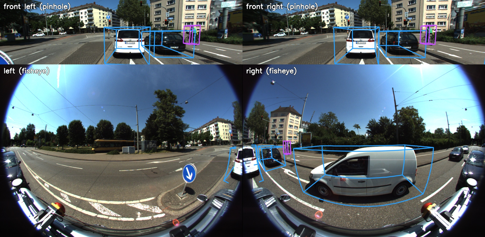
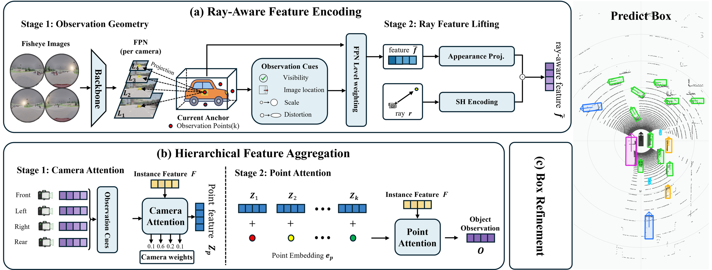
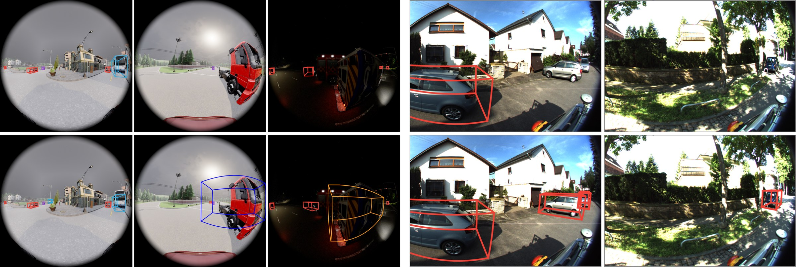
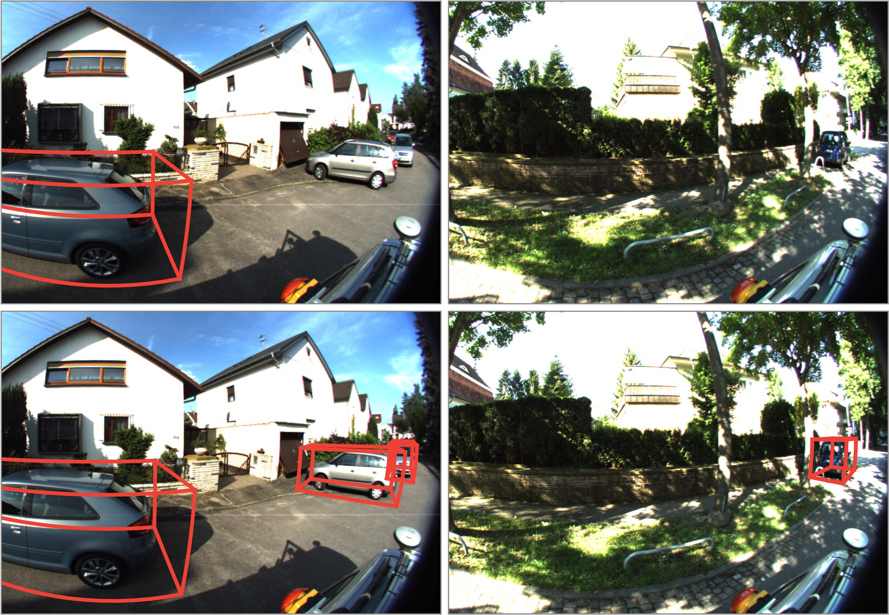

# ROSA

**[WACV 2027] Ray-aware Observation Selection and Aggregation for Surround-View Fisheye 3D Detection**

DongHun Kim, Sang Jun Lee, HyungGi Jo<sup>†</sup> &nbsp;&nbsp;<sub><sup>†</sup> Corresponding author</sub>

**Downloads** (Hugging Face):
[Fisheye3DOD](https://huggingface.co/datasets/danny042/Fisheye3DOD) ·
[KITTI-360 fisheye](https://huggingface.co/datasets/danny042/KITTI-360-fisheye) —
datasets, info files and ROSA checkpoints (in `checkpoints/` of each repository)

ROSA is a camera-only 3D object detector for surround-view **fisheye** cameras.
It runs on the raw fisheye images, without undistortion, and for every
observation of an object it decides which camera and which feature scale to
trust, from where and how the object appears in each fisheye view.

<p align="center">
  
  
</p>

## News

- **[2026/11/10]** Datasets and checkpoints are now available on Hugging Face.
- **[2026/10/15]** ROSA has been accepted to WACV 2027!
- **[2026/10/15]** The official implementation is now publicly available.

## Overview

<p align="center">
  
</p>

## Qualitative results

Sparse4D (top) and ROSA (bottom) on Fisheye3DOD and KITTI-360.

<p align="center">
  
  
</p>

## Getting started

1. [Installation](docs/INSTALL.md): create a Python environment and run `bash tools/install.sh`.
2. [Data](docs/DATA.md): download the datasets and checkpoints from Hugging Face.
3. [Train and evaluate](docs/GETTING_STARTED.md): one command each.

Results of all compared methods: [docs/RESULTS.md](docs/RESULTS.md).

## Citation

Accepted to WACV 2027. The proceedings citation will be added upon publication.

```bibtex
@unpublished{ROSA,
  title  = {ROSA: Ray-aware Observation Selection and Aggregation for
            Surround-View Fisheye 3D Detection},
  author = {Kim, DongHun and Lee, Sang Jun and Jo, HyungGi},
  year   = {2026},
  note   = {WACV 2027}
}
```

## License and acknowledgement

ROSA is released under the [MIT License](LICENSE). It is built on
[Sparse4D](https://github.com/HorizonRobotics/Sparse4D) (MIT, see [its license](projects/mmdet3d_plugin/LICENSE)) and evaluated on
[Fisheye3DOD](https://github.com/weiyangdaren/Fisheye3DOD) and
[KITTI-360](https://www.cvlibs.net/datasets/kitti-360/). We thank the authors
for their great work and for making it publicly available.
