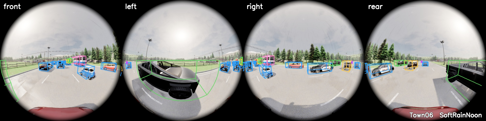
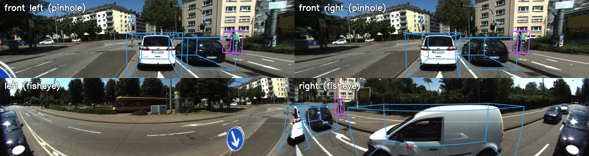
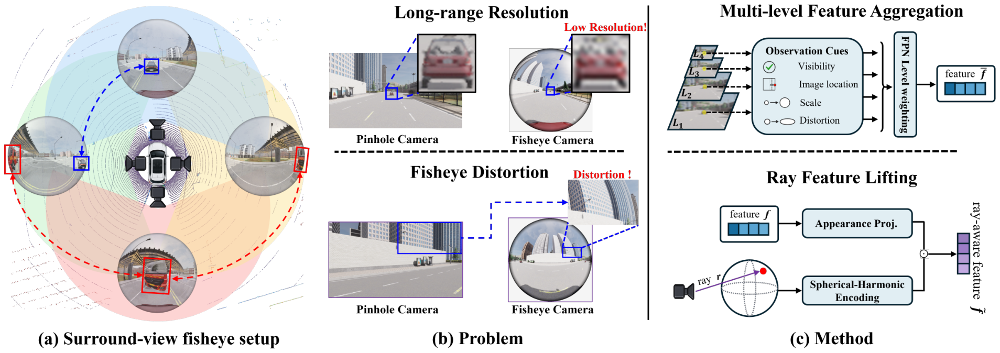
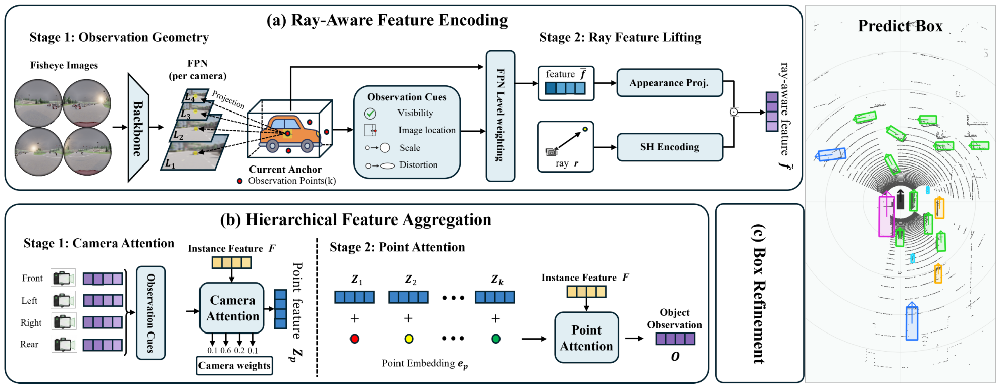
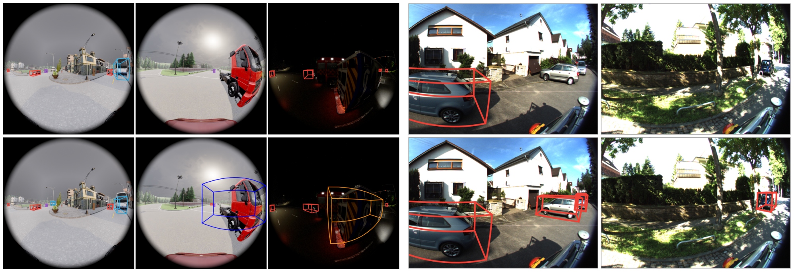
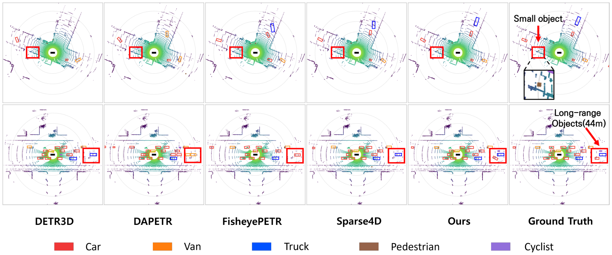

# ROSA

**[WACV 2027] Ray-aware Observation Selection and Aggregation for Surround-View Fisheye 3D Detection**

DongHun Kim, Sang Jun Lee, HyungGi Jo<sup>†</sup> &nbsp;&nbsp;<sub><sup>†</sup> Corresponding author</sub>

ROSA is a camera-only 3D object detector for **surround-view fisheye cameras**.
It works directly on the raw fisheye images, without undistortion, and decides
which camera and which feature scale to trust for each observation of an
object, based on where and how that object appears in each fisheye view.

<p align="center">
  
  
</p>

## News

- **[2026/11/10]** Code cleaned up; datasets and checkpoints moved to Hugging Face.
- **[2026/10/15]** ROSA has been accepted to WACV 2027!
- **[2026/10/15]** The official implementation is now publicly available.

## Overview

<p align="center">
  
</p>

<p align="center">
  
</p>

## Qualitative results

<p align="center">
  
</p>

<p align="center">
  
</p>

## Getting started

| | |
|---|---|
| [Installation](docs/INSTALL.md) | environment, CUDA ops |
| [Data](docs/DATA.md) | Fisheye3DOD and KITTI-360 download, pretrained weights |
| [Getting started](docs/GETTING_STARTED.md) | checkpoints, evaluation, training, runtime |
| [Results](docs/RESULTS.md) | comparison tables and ablation |

## Citation

Accepted to WACV 2027. The proceedings citation will be added upon publication.

```bibtex
@unpublished{ROSA,
  title  = {ROSA: Ray-aware Observation Selection and Aggregation for
            Surround-View Fisheye 3D Detection},
  author = {Kim, DongHun and Lee, Sang Jun and Jo, HyungGi},
  year   = {2026},
  note   = {WACV 2027}
}
```

## License and acknowledgement

ROSA is released under the [MIT License](LICENSE). It is built on
[Sparse4D](https://github.com/HorizonRobotics/Sparse4D) and evaluated on
[Fisheye3DOD](https://github.com/weiyangdaren/Fisheye3DOD) and
[KITTI-360](https://www.cvlibs.net/datasets/kitti-360/). We thank the authors
for their great work and for making it publicly available.
